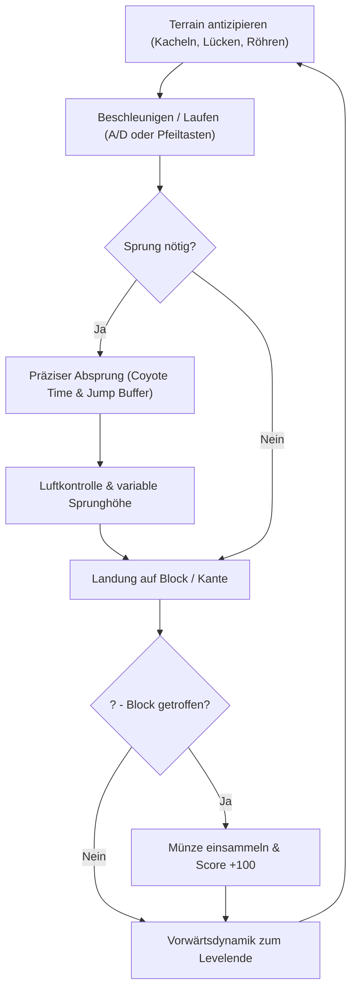

# 01 - High Concept & Core Gameplay Loop

## High Concept
**Retro Platformer (VGLC Mario 1-1)** ist ein archetypischer 2D/2.5D-Tile-Platformer basierend auf dem wissenschaftlichen *Video Game Level Corpus* (VGLC, AAAI 2016). Der Spieler steuert eine Spielfigur durch das vollständige legendäre erste Level von *Super Mario Bros.* (World 1-1 mit 202 Spalten), überwindet 4 Röhren aufsteigender Höhe, 3 Abgründe, brick-Strukturen und die finale Pyramidentreppe bis zur Zielflagge.

- **Genre:** 2D / 2.5D Tile-Platformer
- **Datenbasis:** VGLC ASCII-Matrix (`levels/mario-1-1.txt`, 202 $\times$ 14 Kacheln)
- **Duale Ziel-Plattformen:**
  - **Godot 4:** 2D Nativ (`TileMapLayer`, `CharacterBody2D`, GDScript)
  - **Babylon.js:** 2.5D Web (`InstancedMesh`, Fixed-Z-Camera, TypeScript)
- **Leitprinzip:** Plattformunabhängiges Spec-Driven Intent-Engineering

---

## Core Gameplay Loop (5–10 Sekunden)

1. **Beobachten & Antizipieren:** Der Spieler erkennt Abgründe, Stufen und `?`-Blöcke im heranscrollenden Viewport.
2. **Kinematik:** Beschleunigung mit Reibung vermittelt physikalische Masse.
3. **Präziser Sprung:** Coyote Time verzeiht späte Absprünge; Jump Buffering verhindert Frust vor der Landung.
4. **Interaktion:** Das Anstoßen von Blöcken von unten erzeugt haptisches Feedback und erhöht den Punktestand.
5. **Zielerreichung:** Der Levelabschnitt gipfelt am Flaggenmast (`F`).

---

## Win- & Loss-Bedingungen

* **Siegbedingung (Victory):**
  - Berührung des Zielflaggen-Knotens `F` am Ende des Levels (`State -> VICTORY`).
* **Verlustbedingung (Game Over):**
  - Absturz in einen Abgrund ($y > \text{Todesgrenze}$) setzt den Spieler an den Start zurück (`State -> FALLEN`).

---

## Scoring-Modell
- **Münzenblock (`?`):** $+100$ Punkte pro Kachelkontakt von unten.
- **Zielbonus:** $+1000$ Punkte bei Berührung der Zielflagge.
