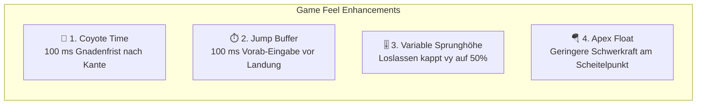

# 02 - Input, Kinematik & Game Feel

## Steuerungsachsen

| Aktion | Tastatur | Gamepad | Beschreibung |
|---|---|---|---|
| **Laufen Links** | `A` oder `ArrowLeft` | D-Pad Links / Stick | Beschleunigt negativ auf X-Achse |
| **Laufen Rechts** | `D` oder `ArrowRight` | D-Pad Rechts / Stick | Beschleunigt positiv auf X-Achse |
| **Springen** | `Space`, `W` oder `ArrowUp` | Button A / Kreuz | Startet Sprungimpuls auf Y-Achse |
| **Reset / Neustart**| `R` | Select | Setzt Spieler auf Startposition zurück |

---

## Kinematik: Beschleunigung & Reibung

Der Spieler darf sich nicht wie ein digitaler Schalter (0 oder Max) bewegen:
- **Beschleunigung (`ACCELERATION`):** Wenn Taste gedrückt, nähert sich $v_x$ der Maximalgeschwindigkeit $v_{\max}$.
- **Reibung / Verzögerung (`FRICTION`):** Wenn keine Taste gedrückt ist, bremst $v_x$ exponentiell auf 0 ab:
  $$v_x(t + \Delta t) = v_x(t) \cdot (1 - \text{friction} \cdot \Delta t)$$
- **Luftreibung (`AIR_RESISTANCE`):** In der Luft ist die horizontale Richtungsänderung träger (ca. 60 % der Bodenbeschleunigung).

---

## Die 4 Säulen des Platformer-Game-Feels

### 1. Coyote Time (Gnadenfrist)
- Fällt der Spieler von einer Kante, ohne vorher gesprungen zu sein, läuft ein Timer (`coyote_timer = 0.1s`).
- Solange der Timer aktiv ist, gilt der Spieler als absprungberechtigt (`can_jump = true`).

### 2. Jump Buffering (Vorab-Pufferung)
- Drückt der Spieler die Sprungtaste bis zu $100\text{ ms}$ vor der Bodenberührung, wird die Eingabe gepuffert (`jump_buffer = 0.1s`).
- Sobald `on_ground` wahr wird, feuert der Sprung im selben Frame automatisch.

### 3. Variable Sprunghöhe
- Lässt der Spieler die Sprungtaste los, während $v_y < 0$ (Aufwärtsbewegung), wird die vertikale Geschwindigkeit sofort um $50\ \%$ reduziert:
  $$\text{if (!jump\_pressed \&\& } v_y < 0 \text{) } v_y \gets v_y \cdot 0.5$$

### 4. Apex Float (Luftkontrolle)
- Am Scheitelpunkt des Sprungs ($|v_y| < 2.0$) wird die Gravitation um $30\ \%$ reduziert, um dem Spieler maximale Zielführung im Flug zu ermöglichen.
