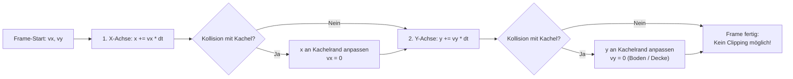

# 03 - Duale Systemarchitektur: Godot 4 vs. Babylon.js

## Das fundamentale Prinzip: Diskrete Kachelwelt

Die Levelkarte wird als 2D-Zeichenmatrix aus `levels/mario-1-1.txt` (202 $\times$ 14 Kacheln) geladen:
- **Kachelgröße:** $\text{tileSize} = 1.0\text{ Units}$ (oder $32\text{ px}$ in 2D)
- **$\mathcal{O}(1)$-Kollisions-Lookup:**
  $$\text{tile}_X = \lfloor x / \text{tileSize} \rfloor, \quad \text{tile}_Y = \lfloor y / \text{tileSize} \rfloor$$

---

## Die Physik-Regel: Axis-Separated AABB

Simultane 2D-Kollisionskorrektur führt bei Agenten zwingend zu Tunneling und Kanten-Klemmern. Die Bewegung **muss achsengetrennt** berechnet werden:



---

## Ziel-Implementierung A: Godot 4 (2D Native)

```text
res://
├── project.godot            # Engine-Konfig (Viewport: 1280x720)
├── main.tscn                # Szenen-Wurzel
├── main.gd                  # Level-Parser & Spawner
├── config.gd                # Zentrale Physik- & Game-Feel-Parameter
├── player.gd                # CharacterBody2D mit move_and_slide()
└── test_platformer.gd       # Headless Integrationstest (SceneTree)
```

- **Node-Hierarchie:**
  - `Node2D` (Root)
    - `TileMapLayer` (Parst VGLC-Matrix in Kacheln mit Kollisionsformen)
    - `CharacterBody2D` (Spieler mit `CollisionShape2D` Box)
    - `Camera2D` (mit `position_smoothing_enabled = true` und Drag Margins)
    - `Parallax2D` (Mehrschichtige Hintergrundberge)
- **Physik-Vorteil:**
  - `move_and_slide()` führt interne Axis-Separation und Schrägenkollision vollständig engine-nativ aus.

---

## Ziel-Implementierung B: Babylon.js (2.5D Web)

```text
src/
├── core/
│   ├── tilemap.ts           # VGLC-Matrix-Parser & O(1) Lookup
│   ├── physics.ts           # Axis-Separated AABB-Kollision
│   ├── player.ts            # Kinematik, Coyote Time, Jump Buffer
│   └── state.ts             # State Machine & Transitions
├── render/
│   ├── scene.ts             # Babylon.js Scene, Light, Shadows
│   ├── blocks.ts            # InstancedMeshes für X, S, ? bei Z = 0
│   └── camera.ts            # TargetCamera bei Z = -18 mit Lerp
└── config.ts                # Plattformneutrale Parameter
```

- **2.5D-Projektions-Prinzip:**
  - **Spielebene:** Alle Kacheln und der Spieler liegen exakt bei $Z = 0$.
  - **Kamera:** Frontale TargetCamera bei $Z = -18$ (Perspektivisch oder Orthografisch).
  - **Hintergrund:** Berge und Wolken bei $Z = +15$ $\implies$ **Automatische 3D-Tiefenparallaxe ohne manuellen Berechnungsaufwand!**
  - **Beleuchtung:** Ein gerichtetes Spotlight erzeugt dramatische Seitenschatten auf den Kanten der 3D-Blöcke.
