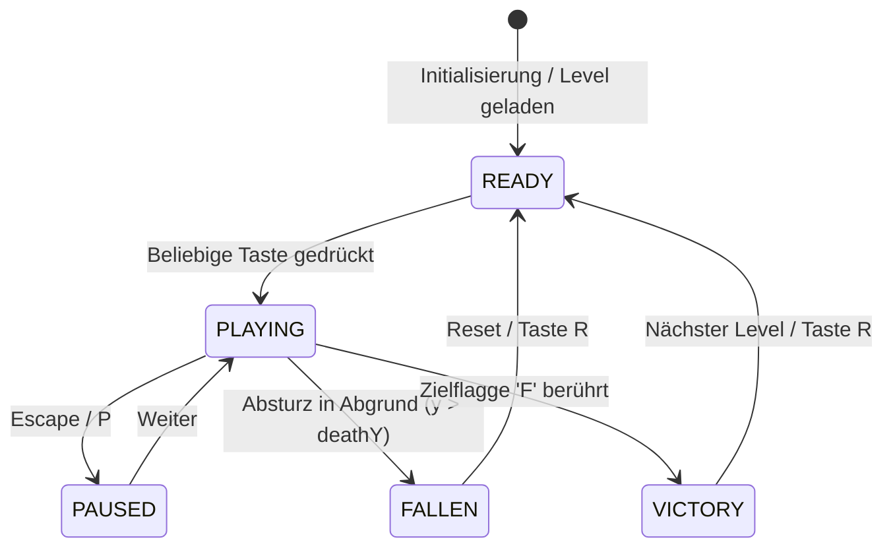

# 04 - Zustandsautomat (State Machine)

## Spielzustände

---

## Zustandsdefinitionen & Regeln

### 1. `READY` (Startbereit)
- Levelmatrix ist eingelesen und instanziiert.
- Spieler steht am Startpunkt ($x = 2$, $y = \text{ground}$).
- Kamera blickt auf den Spieler; Physik ruht.

### 2. `PLAYING` (Aktives Gameplay)
- Volle AABB-Physikschleife und Game-Feel-Timer aktiv.
- Viewport folgt der Spielerposition auf der X-Achse.
- Score zählt Münzen und Fortschritt.

### 3. `PAUSED` (Pause)
- Physikschleife eingefroren ($\Delta t = 0$).
- Overlay "PAUSE" eingeblendet.

### 4. `FALLEN` (Absturz / Game Over)
- Tritt ein, wenn Spieler unter die unterste Kachelzeile fällt.
- Eingaben werden blockiert; Respawn-Aufforderung wird eingeblendet.

### 5. `VICTORY` (Levelziel erreicht)
- Tritt ein, wenn der Spieler die Kachel `F` (Flagpole) berührt.
- Highscore wird finalisiert; Sieges-Feedback (Glow/Sound).
